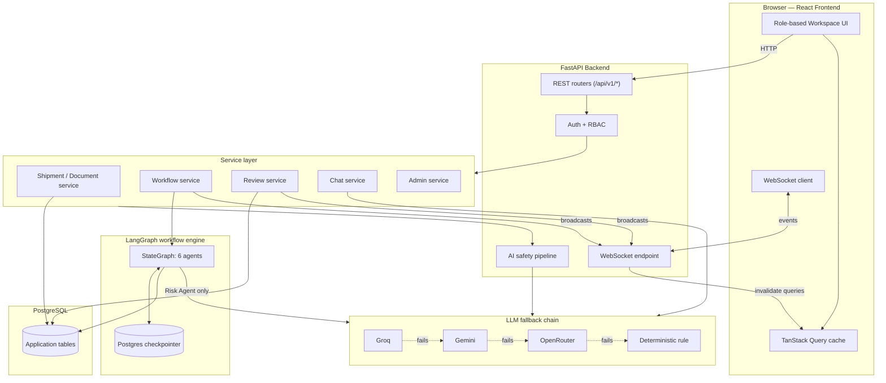

# Pantheon — Colombo Port Congestion & Customs Clearance

**Innodata AI Catalyst '26 — University Track (Sri Lanka)**
**Domain:** Logistics
**Team:** Pantheon

## Problem Statement

Vessel arrival data, customs/trade documentation, and port yard/berth capacity
live in three disconnected systems, each owned by a different stakeholder:

- **Shipping agents** — vessel schedules and arrival notices
- **Sri Lanka Customs** — trade documentation and clearance declarations
- **Sri Lanka Ports Authority (SLPA)** — yard and berth capacity

Because none of these systems talk to each other, problems like missing
documents or inconsistent declarations are typically only caught *after* a
vessel has already berthed — at which point the cost of delay has already
been incurred. At the same time, staffing at clearance and inspection points
is limited, so officers lack a reliable way to prioritize which shipments
genuinely warrant manual review versus which can proceed without delay.

## What Pantheon Is

Pantheon is a working full-stack system — not a mockup — built around a
single multi-agent AI pipeline that ties vessel tracking, trade
documentation, and port capacity into one shared, continuously updated
operational picture, with a human customs officer kept in the loop for every
consequential decision. It consists of:

- A **FastAPI backend** (`project/backend/`) running a six-agent LangGraph
  workflow, backed by PostgreSQL, with full JWT authentication, role-based
  access control, a shared AI-safety pipeline, and realtime WebSocket
  delivery.
- A **React frontend** (`project/frontend/`) providing one role-specific
  workspace per stakeholder (shipping agent, customs officer, port
  operations, importer/exporter, management, admin), each talking to the
  same backend API and WebSocket stream.

Both halves are documented in depth in their own READMEs — this file is the
project-level overview: what was built, why it was built this way, and how
the pieces fit together.

## System Architecture



Everything backend-side runs in a single FastAPI process (a modular monolith,
not microservices); the "multi-agent" part of the system lives at the
*orchestration* layer, not the deployment layer. See
[`project/backend/README.md`](project/backend/README.md) for the full
rationale.

## The Six-Agent Workflow

The actual implemented graph (`project/backend/app/workflows/graph.py`) runs
as a straight line through four ingestion/analysis agents, then branches on
risk:

```
Tracking Agent → Documentation Agent → Congestion Agent → Risk & Inspection Agent
                                                                   │
                                        ┌──────────────────────────┴───────────────────────────┐
                                        │ low risk / confident                 high-risk, ambiguous, or
                                        ▼                                       inconsistent document
                                 Scheduling Agent                                        ▼
                                        │                              Escalation & Human Oversight Agent
                                        │                                   (interrupt — pauses here)
                                        │                                              │
                                        │                               human officer decides, graph resumes
                                        │                                              │
                                        └──────────────────────┬───────────────────────┘
                                                                ▼
                                                            Finalize
```

1. **Tracking Agent** — ingests vessel position/speed/ETA (a disclosed
   simulator standing in for a live AIS feed, since live AIS access was out
   of scope). Its output also upserts a `Vessel` row and records a
   `VesselPosition`, so the Port Operations workspace has real rows to list
   instead of only ever showing the transient per-run output.
2. **Documentation Agent** — extracts structured fields (bill-of-lading
   number, container number, vessel name, certificate number) from an
   uploaded PDF and validates them against what's required for that document
   type. Extraction runs on the document's raw text, not a PII-redacted
   copy — a bill-of-lading number is a document reference, not personal
   data, and redacting first would (and during testing, did) destroy it.
3. **Congestion Agent** — combines the tracking signal with a historical
   baseline to forecast berth congestion ahead of time.
4. **Risk & Inspection Agent** — the one agent that calls an LLM directly,
   classifying risk and recommending proceed-or-inspect from a *summary* of
   upstream signals, never raw document content. If every LLM provider
   fails, a deterministic rule takes over: any document that's inconsistent
   *or* missing required fields is treated as warranting inspection.
5. **Scheduling Agent** — produces a berth/resource recommendation. It
   executes nothing; it's a recommendation, same as everything upstream of
   the human gate.
6. **Escalation & Human Oversight** — the mandatory gate. If risk is high,
   confidence is low, or the document is inconsistent, the graph calls
   LangGraph's `interrupt()` here — a genuine pause, with a checkpoint
   written to Postgres — rather than a status flag a bug elsewhere could
   skip. A pending review is created and authorized WebSocket clients are
   notified. When an officer decides, the graph resumes from that exact
   point via `Command(resume=...)`; nothing upstream re-runs.

Five of the six nodes (everything except escalation, to avoid interfering
with `interrupt()`) are wrapped with instrumentation that persists an
`AgentRun`/`AgentResult` row per execution — this is what populates the
Admin "Agent Runs" view with real data, not a simulated log.

## Why This Architecture

| Decision | Reasoning |
|---|---|
| **Multi-agent, not single-pass** | A single model asked to produce "risk: high" gives a label. Decomposing into six narrow agents means each one's output is independently inspectable, testable, and replaceable — and a reviewing officer sees *why*, broken down by which upstream signal drove the decision, not an opaque score. |
| **LangGraph over a plain sequential script** | A script can run six functions in order, but it cannot pause mid-execution, persist exactly where it paused, and resume later — possibly hours later, possibly after a server restart — without re-running everything upstream. LangGraph's `interrupt()` / `Command(resume=...)` mechanism, backed by a durable Postgres checkpointer, is what makes the human-review gate real rather than simulated. |
| **A modular monolith, not microservices** | Splitting tracking, documentation, risk, scheduling, and review into separately deployable services would add real operational complexity (service discovery, network calls, distributed transactions) that buys nothing at this scale and works against the actual requirement — one shared, unified operational picture. |
| **Backend-enforced RBAC, not frontend route guards** | A frontend can hide a button; it cannot be trusted to be the only thing standing between a user and an action. Every protected backend endpoint re-resolves the caller's permissions from the database on every request, and every resource-scoped action is checked again independently. The frontend's role-based routing is explicitly a UX convenience in its own code comments, never the security boundary. |
| **Three-provider LLM fallback (Groq → Gemini → OpenRouter), with a deterministic floor** | LLM providers have rate limits, outages, and — directly experienced during this project's development — models that get deprecated with only months' notice. A system whose risk pipeline goes down the moment one vendor has a bad day isn't something a port would actually run. If every provider fails or none are configured, a deterministic rule still produces a conservative, explainable result; the pipeline never simply stops working. |
| **A shared AI-safety pipeline for every LLM-facing input** | A trade document is an externally supplied, adversarial input channel — a shipper has every incentive to try to game an automated system. Every path that touches an LLM goes through the same input validation, prompt-injection screening, and PII redaction before reaching a model, and the same structured-output validation before its result is trusted downstream. |
| **TanStack Query + WebSocket-driven invalidation on the frontend, no Redux** | Almost all frontend state here is server state (shipments, reviews, workflow progress), not client-only UI state. TanStack Query's cache plus targeted invalidation on specific WebSocket events (e.g. `review.created` invalidates the reviews query) gives a live-updating UI without polling and without a second state-management layer duplicating what the server already owns. |

## Human-in-the-Loop, in Practice

Port and customs decisions carry real financial and regulatory consequences,
so no agent is allowed to make a final, consequential call unsupervised. The
escalation gate is backed by a genuine execution pause: if the server
restarts between the interrupt and the officer's decision, the checkpoint
already written to Postgres is what makes resuming from exactly that point
still possible. This is also why the system persists a `context_snapshot`
(tracking, document, congestion, and risk results) onto the pending review
record at the moment of escalation — it's the one point that all of that
upstream state is available anywhere outside LangGraph's own checkpoint, and
it's what lets a reviewing officer see the full evidence behind a flagged
shipment immediately, rather than starting from nothing.

## Use Cases

1. **Shipping agent submits a clean shipment** — registers it, uploads a
   bill of lading, triggers the workflow, and gets a `workflow_id`
   immediately without waiting for the pipeline to finish. A low-risk
   shipment completes end-to-end with a recommended berth and scheduling
   window attached, no human step required.
2. **Shipping agent submits an incomplete document** — the Documentation
   Agent reports `MISSING_FIELDS` instead of inventing a value; because an
   incomplete declaration is itself a risk signal, the shipment is routed to
   human review rather than let through automatically. The frontend also
   blocks starting a workflow at all with zero uploaded documents, since
   that outcome is already knowable without running the pipeline.
3. **Customs officer works the review queue** — opens the pending queue,
   opens one review and sees the full upstream evidence that led to the
   escalation, then approves, rejects, or requests more information. The
   paused workflow resumes exactly where it left off; a second officer
   attempting to decide the same review gets a `409 Conflict`, not a silent
   double-decision.
4. **Customs officer asks the chat assistant about their queue** — a
   role-specific assistant answers using the same authorization-checked
   tools a REST endpoint would use, and says plainly if every LLM provider
   is temporarily unavailable instead of returning an error.
5. **Port operations watches congestion and vessel activity live** — a
   WebSocket connection delivers `workflow.*` and `tracking.*` events as
   shipments are processed, without polling; `review.*` events are never
   delivered to this role, even on the same authenticated connection.
6. **Management checks aggregate performance** — a dashboard of totals and
   breakdowns by status and risk level, deliberately without drilling into
   any individual shipment's internal risk evidence or a specific officer's
   decisions.
7. **Admin monitors system health, without a chatbot** — health, user
   management (create/role/status), agent-run history, and audit views.
   There is deliberately no chat assistant available to this role: the admin
   workspace is a technical console, not an operational one.

## Tech Stack

| Layer | Technology |
|---|---|
| Agent orchestration | LangGraph (`StateGraph`, conditional edges, Postgres-backed checkpointer) |
| Backend | Python, FastAPI, SQLAlchemy 2 (async), Alembic |
| Frontend | React 19, Vite, React Router, TanStack Query, Tailwind CSS v4, three.js |
| Database | PostgreSQL (application data and LangGraph checkpoints, same server) |
| Auth | JWT, backend-enforced role-based access control |
| LLM providers | Groq → Gemini → OpenRouter, with a deterministic fallback underneath all three |

## Repository Layout

```
Pantheon - Innodata/
├── docker-compose.yml        # PostgreSQL (host port 5433 → container 5432)
├── build_plans/              # Planning docs, test guides, bug log — gitignored
├── docs/                     # Original proposal and architecture detail
└── project/
    ├── backend/               # FastAPI + LangGraph backend — see its README
    └── frontend/              # React frontend — see its README
```

## Documentation

- [`project/backend/README.md`](project/backend/README.md) — full backend
  architecture, the workflow in detail, security model, use cases, setup,
  and an index of every backend subpackage's own README.
- [`project/frontend/README.md`](project/frontend/README.md) — full frontend
  architecture: routing, state management, API/WebSocket integration, and
  component structure.
- [`docs/`](docs/) — the original competition proposal and architecture
  writeup, including the benchmarking plan (multi-agent vs. single-agent
  baseline) and the data-sourcing/disclosure approach for simulated
  components.
