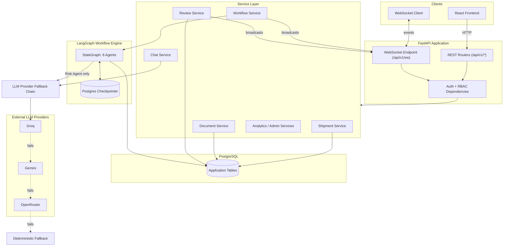
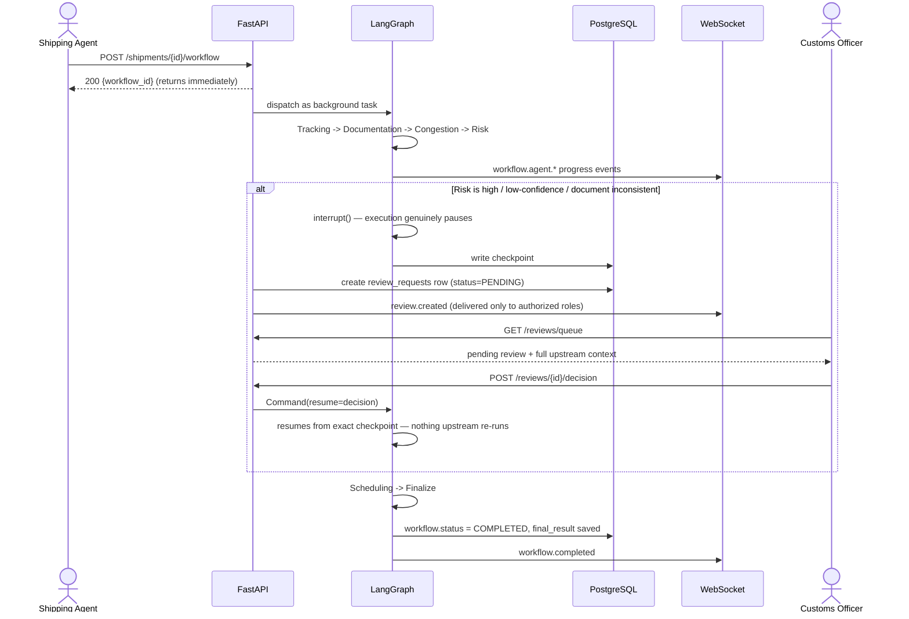

# Pantheon Backend

## What this is

Pantheon is a multi-agent AI system for a specific, real operational problem: the Port of Colombo has been experiencing chronic congestion and slow, error-prone customs clearance, because vessel tracking (handled by shipping agents), customs documentation (handled by Sri Lanka Customs), and yard/berth planning (handled by the Sri Lanka Ports Authority) live in three disconnected systems that don't talk to each other in a timely way. A missing signature or an expired certificate is typically discovered only after a vessel has already berthed — at which point the cost of the delay is far higher than if it had been caught while the vessel was still at sea. Customs officers, meanwhile, have to decide which shipments warrant a manual inspection under real staffing constraints, with incomplete visibility and no systematic way to flag the few shipments that genuinely need scrutiny.

This backend is the engineering response to that problem: one shared, continuously updated operational picture for every stakeholder, built around a pipeline of specialized AI agents that catch documentation and risk problems early, forecast congestion before it forms, and — critically — never let an automated system make the final call on anything consequential. A human customs officer always has the last word on a flagged shipment, and the system is built so that officer's decision is fast to make (full context is already assembled) and fully auditable afterward (every agent's reasoning is a structured, inspectable record, not a single opaque model output).

That last point is also the project's core technical thesis, and the reason this is a *multi-agent* system rather than one model asked to do everything in a single pass: decomposing the problem into specialized agents — one for tracking, one for documentation, one for congestion forecasting, one for risk, one for scheduling, and one dedicated purely to deciding whether a human needs to step in — means each agent's output is independently inspectable, independently testable, and independently replaceable. A single-agent system that produces "risk: high" gives you a label; this system gives you *why*, broken down by which upstream signal drove the decision, with each agent's input and output persisted as a separate, structured record.

## Architectural philosophy

The backend is a **modular monolith**, not a set of microservices. One FastAPI application, one PostgreSQL database, one LangGraph workflow engine, all in the same process. This was a deliberate choice, not a shortcut: splitting tracking, documentation, risk, scheduling, and review into separate deployable services would add real operational complexity (service discovery, network calls between agents, distributed transactions, independent deployment pipelines) that buys nothing at this scale and would actively work against the core requirement — a shared, unified operational picture. The "multi-agent" part of the system lives at the *orchestration* layer (LangGraph's `StateGraph`), not at the *deployment* layer. Agents are modular Python functions operating on shared, typed state; they are not separate services.

Within that monolith, responsibilities are still strictly separated by layer:

- **API routers** (`app/api/`) only handle HTTP/WebSocket concerns: parsing requests, checking permissions, calling a service, shaping a response. They contain no business logic.
- **Services** (`app/services/`) hold the actual business logic and orchestration — the thing that decides *what* happens when a shipment is created, a document is uploaded, or a review is decided.
- **Repositories** (`app/repositories/`) are the only code that talks to the database directly. Services never write raw queries.
- **The workflow engine** (`app/workflows/`) is a separate concern from both: it's where the actual multi-agent reasoning happens, invoked *by* a service (`workflow_service.py`) but implemented independently of any particular API shape.

This separation is what makes the system's two most important properties possible: every sensitive action re-checks its own authorization regardless of which layer called it (so there's no single point where a permission check can be silently bypassed), and the human-review gate is a real, durable pause in execution — not a status flag that a service layer could accidentally skip.

## System architecture



Everything runs in one process. The dotted arrows in the LLM chain only fire on failure — the common case is a single successful call to Groq.

## Why these specific technology choices

| Choice | Why |
|---|---|
| **FastAPI** | Native async support (needed throughout, since every agent, every database call, and the checkpointer are all async), automatic OpenAPI docs for free, and a dependency-injection system that makes "every route resolves its own permissions" a natural pattern rather than something bolted on. |
| **LangGraph** | This is the one piece of technology the whole design pivots on. A plain sequential script could run six functions in order, but it could not *pause mid-execution*, persist exactly where it paused, and *resume later* from a completely different process (a customs officer deciding on a review, possibly hours later) without re-running everything that came before. LangGraph's `interrupt()` / `Command(resume=...)` mechanism, backed by a durable checkpointer, is what makes the human-review gate real rather than simulated. |
| **PostgreSQL + the LangGraph Postgres checkpointer, same server, separate tables** | The business data (shipments, documents, reviews) and the graph's execution checkpoints are two different kinds of state with two different lifecycles, but there's no reason to run two databases for a project this size. LangGraph manages its own tables (`checkpoints`, `checkpoint_writes`, …); the application's SQLAlchemy models never touch them, and the reverse is also true. |
| **SQLAlchemy 2 (async) + Alembic** | Async end-to-end, matching FastAPI's model, with Alembic giving a real, versioned migration history instead of just letting the app auto-create tables — useful even for a single developer, since it's the difference between "change a model" meaning "write a migration" versus "silently diverge from whatever's actually in the database." |
| **JWT + backend-enforced RBAC, not frontend route guards** | A frontend can hide a button; it cannot be trusted to be the *only* thing standing between a user and an action. Every protected endpoint re-resolves the caller's permissions from the database on every request (`require_permission(...)` in `app/auth/dependencies.py`), and every resource-scoped action (can this shipping agent see *this specific* shipment) is checked separately again (`app/permissions/resource_access.py`). A role being allowed to do something in general never implies it's allowed to do that thing to someone else's data. |
| **Three-provider LLM fallback (Groq → Gemini → OpenRouter), not one hardcoded provider** | LLM providers have rate limits, outages, and (as this project directly experienced during development) models that get deprecated with only a few months' notice. A system whose risk-assessment pipeline goes down the moment one vendor has a bad day isn't something a port would actually run. The fallback chain means a provider failure degrades gracefully instead of breaking the pipeline, and if every provider fails (or none are configured at all), there's still a deterministic, rule-based fallback underneath all three — the system never simply stops working because an API call didn't go through. |
| **A shared AI safety pipeline, not per-agent ad hoc checks** | Trade documents are an externally-supplied, adversarial input channel — a shipper has every incentive to try to game an automated system, and a malicious or malformed document is not meaningfully different, from a security standpoint, from a user typing something into a chat box. Every path that touches an LLM — agent reasoning, chat assistants, document text — goes through the same input validation, prompt-injection screening, and PII redaction before it reaches a model, and the same structured-output validation before its result is trusted. | |

## The multi-agent workflow, in detail

The heart of the system is a single LangGraph `StateGraph` with six nodes operating over one shared, typed state object (`app/workflows/state.py`):

```
Tracking Agent ──┐
                  ├──► Congestion Agent ──┐
Documentation ────┘                       ├──► Risk & Inspection Agent ──► (escalate?) ──► Scheduling Agent ──► Finalize
    Agent                                 │            │
                                          ─┘            └── if ambiguous/high-risk/low-confidence:
                                                               pause (interrupt) ──► human officer decides ──► resume
```

- **Tracking Agent** — an ingestion node, not an LLM reasoning step. In production this would poll a live AIS feed; here it uses a clearly disclosed simulator (calibrated to be plausible, never silently presented as real data) since live AIS access wasn't part of this project's scope.
- **Documentation Agent** — extracts structured fields (bill-of-lading number, container number, vessel name, certificate number) from an uploaded PDF and validates them deterministically against what's required for that document type. Extraction runs on the document's *raw* text, not a PII-redacted copy — redaction still happens, but a bill-of-lading number is a document reference, not personal data, and redacting it first would (and during testing, did) destroy it by mistake.
- **Congestion Agent** — combines the Tracking Agent's live signal with a historical baseline (again, a disclosed simulator) to forecast berth congestion ahead of time rather than reactively.
- **Risk & Inspection Agent** — the one agent that calls an LLM directly. It's given a *summary* of upstream signals (document status, injection flags, ETA confidence) — never raw document content or personal data — and asked to classify risk and recommend proceed-or-inspect. If every LLM provider fails, a deterministic rule takes over: any document that's inconsistent *or* missing required fields is treated as warranting inspection, so the pipeline's risk logic degrades to something conservative and explainable rather than silently defaulting to "everything's fine."
- **Scheduling Agent** — produces a berth/resource recommendation that accounts for both the congestion forecast and whether the shipment will need an inspection slot. It does not execute anything; it's a recommendation, same as everything upstream of the human gate.
- **Escalation / Human Oversight node** — the mandatory gate. If the Risk Agent's output is high-risk, low-confidence, or the document was flagged inconsistent, the graph calls LangGraph's `interrupt()` here, which genuinely pauses execution and writes a checkpoint — this is not a status field that a bug elsewhere could skip. A pending review record is created (a *business* record, deliberately kept separate from the *execution* checkpoint — see `app/workflows/README.md` for why those two are not the same thing and both are needed), and the connected WebSocket clients authorized to see it are notified. When an officer submits a decision, the graph resumes from that exact point via `Command(resume=...)` — nothing upstream re-runs.

### The escalation / resume cycle, as a sequence

This is the single most important flow in the system — it's the difference between "a pipeline that produces a risk score" and "a pipeline a port could actually trust":



The pause is real: if the server restarts between the interrupt and the officer's decision, the checkpoint in Postgres is what makes resuming from exactly that point still possible.

This is also the system's benchmarking story: the whole point of comparing this pipeline against a single-agent baseline (one model given the same inputs and asked to produce the same risk/scheduling output in one pass) is to test whether the decomposition is worth its added complexity — on accuracy, on false-positive/false-negative inspection-flagging rates, on latency/cost per case, and critically on auditability: a single opaque model output can't be broken down after the fact the way six separately-persisted agent results can.

## Security and safety architecture

Two authorization layers run on every sensitive request, and they answer two different questions:

1. **Permission check** (`require_permission(...)`) — *does this role do this kind of thing at all?* Resolved from the database on every request, never trusted from anything the client sent.
2. **Resource check** (`app/permissions/resource_access.py`) — *is this specifically their resource?* A shipping agent holding `shipment:read_own` still can't read a shipment they don't own or aren't the importer on.

Role-specific AI chat assistants share one runtime (`app/services/chat_service.py`) but differ in system prompt, allowed tools, and retrievable context — and every tool a chat assistant can call re-checks its own authorization independently (e.g. `get_shipment_details` calls the exact same `assert_can_access_shipment` a REST endpoint would), because the model itself is never trusted to enforce access control; tool *availability* to a role is a convenience, not the actual security boundary. The Administrator role deliberately has no chat assistant at all — the admin workspace is a technical monitoring console, not an operational one, and there is nothing for an LLM to usefully do there that wouldn't also be a risk to expose.

WebSocket events follow the identical two-layer idea applied to realtime delivery: being authenticated on a connection is not the same as being authorized to receive a *specific* event. A Customs Officer's connection receives `review.*` events; a Shipping Agent's does not, even though both are valid, authenticated connections (`app/websocket/subscriptions.py`).

The safety pipeline (`app/safety/`) treats every external input the same way regardless of where it came from — a chat message and an uploaded trade document are both untrusted, both screened for embedded instructions before reaching an LLM, and both have personal data redacted (with stable pseudonyms, not deletion, so an authorized workflow can still reason about "this shipment's importer" without ever seeing the importer's actual name). LLM outputs are never trusted directly either: every structured response is validated against a Pydantic schema before anything downstream relies on it, and no AI component — agent or chat assistant — is permitted to independently finalize a consequential outcome like a clearance decision.

## What actually got built, and what's a known gap

This backend was built, then independently tested end-to-end against its own design — every router exercised, including the full submit → workflow → escalate → review → resume cycle, WebSocket delivery with role filtering, chat's success and graceful-degradation paths, and the authorization boundary cases (wrong-owner access, missing permission, expired token, double-deciding a review). Eight real bugs were found and fixed in that process — among them, a Windows-specific event-loop ordering issue that broke the server outright, a regex bug that captured the literal word "Number" instead of a real bill-of-lading number, and a PII redaction pass that was destroying legitimate document reference numbers before extraction ever saw them. The full list, with root cause and fix for each, is in `../../build_plans/Backend_errors.md`.

A small number of features are intentionally unfinished rather than broken: `DocumentExtraction`, `AgentRun`/`AgentResult`, and `AuditLog` all exist as database tables with a clear purpose, but nothing currently writes rows into them — extraction results and agent timing only live in LangGraph's in-memory workflow state for the duration of a run, and the admin audit log is consequently always empty (login events are tracked separately, via `login_events`, and that path does work). Wiring these up is a well-scoped follow-up, not a redesign.

## Use cases

Concrete walkthroughs of what each role actually does with the system, end to end.

### 1. Shipping agent submits a clean shipment

A shipping agent registers a new shipment (`POST /shipments`) and uploads its bill of lading (`POST /shipments/{id}/documents`). They trigger processing (`POST /shipments/{id}/workflow`) and get a `workflow_id` back immediately — they don't wait for the pipeline to finish. The Documentation Agent extracts the bill-of-lading number, vessel name, and container number and finds nothing missing or inconsistent; the Risk Agent classifies it low-risk; no human review is needed. Within a few seconds the agent can poll `GET /workflows/{id}` and see `status: COMPLETED` with a recommended berth and scheduling window already attached.

### 2. Shipping agent submits a shipment with an incomplete document

Same flow, except the uploaded document is missing its container number. The Documentation Agent correctly reports `MISSING_FIELDS` instead of inventing a value or silently ignoring the gap. Because an incomplete declaration is itself a risk signal, the Risk Agent (or its deterministic fallback, if every LLM provider is down) flags the shipment for inspection, and the graph pauses at the human-review gate rather than letting an incomplete declaration through automatically.

### 3. Customs officer works the review queue

A customs officer opens `GET /reviews/queue` and sees every shipment currently paused for a decision, each with its priority and the reason it was escalated. Opening one review surfaces the full upstream context that led to the escalation — tracking data, extracted document fields, the risk classification and its rationale — so the officer isn't starting from nothing. They submit a decision (`POST /reviews/{id}/decision`: approve, reject, or request more information) and the paused workflow resumes exactly where it left off. If a colleague already decided the same review a moment earlier, the second attempt gets a `409 Conflict`, not a silent double-decision.

### 4. Customs officer asks the chat assistant about their queue

Instead of scanning the raw queue, the officer can ask the role-specific assistant directly ("what's pending in my review queue?", "why was this shipment flagged?"). The assistant calls the same authorization-checked tools a REST endpoint would — it never gets database access beyond what the officer themself is allowed to see — and if every LLM provider happens to be unavailable at that moment, it says so plainly instead of returning an error page.

### 5. Port operations watches congestion forecasts live

A port operations user keeps a WebSocket connection open and receives `workflow.*` and `tracking.*` events as shipments are processed across the system, without polling. They never receive `review.*` events (those are scoped to Customs Officer and Admin), even on the same authenticated connection — the filtering happens per event, not per connection.

### 6. Management checks aggregate performance

A management user hits `GET /analytics/dashboard` for a cross-cutting view: total shipments, breakdown by status and risk level, total workflows run. They see aggregates only — never an individual shipment's internal risk evidence or a specific officer's review decisions, since that level of detail isn't part of what the Management role's permissions expose.

### 7. Admin monitors system health, without a chatbot

An administrator checks `GET /admin/health`, `/admin/users`, `/admin/agent-runs`, and `/admin/audit` to confirm the system is operating correctly and to manage accounts. There is deliberately no `POST /chat/conversations` available to this role (it returns `403 Forbidden` even though the admin is otherwise a superuser) — the admin workspace is a technical console, not an operational one, and giving an LLM assistant standing access to system administration isn't a risk worth taking for a feature nobody in that role actually needs.

## Tech stack

- **FastAPI** for the HTTP and WebSocket API.
- **SQLAlchemy 2** (async) for the ORM/data layer, with **PostgreSQL** as the database.
- **Alembic** for schema migrations.
- **LangGraph**, with a Postgres-backed checkpointer, for the multi-agent workflow engine.
- **JWT-based authentication** with role-based access control (RBAC), enforced server-side on every request.

## Setup

1. Create and activate a virtual environment, then install dependencies:
   ```bash
   python -m venv .venv
   .venv\Scripts\activate   # on Windows
   pip install -r requirements.txt
   ```
2. Copy `.env.example` to `.env` and fill in at least:
   - `DATABASE_URL`
   - `JWT_SECRET_KEY`
   - one LLM provider key (`GROQ_API_KEY`, `GOOGLE_API_KEY`, or `OPENROUTER_API_KEY`) — see below for why none of them are strictly required.
3. Start PostgreSQL via the `docker-compose.yml` at the repository root (one level above this `backend/` directory):
   ```bash
   docker compose up -d
   ```
4. Apply database migrations:
   ```bash
   alembic upgrade head
   ```
5. Seed baseline roles, permissions, and demo users:
   ```bash
   python -m scripts.seed_data
   ```
6. Start the server:
   ```bash
   python run_server.py
   ```
   Use `run_server.py` rather than `uvicorn app.main:app` directly — on Windows, Uvicorn creates its event loop before importing the app module, which is too late to apply the Windows-safe event loop policy that the async Postgres driver needs. See `app/README.md` for details.

Once running, the API is served under the `/api/v1` prefix, with a liveness check at `GET /health`.

## Demo logins

`python -m scripts.seed_data` creates one demo user per role, all sharing the same password:

| Email | Password |
|---|---|
| `shipping_agent@pantheon.demo` | `Pantheon123!` |
| `customs_officer@pantheon.demo` | `Pantheon123!` |
| `port_operations@pantheon.demo` | `Pantheon123!` |
| `importer_exporter@pantheon.demo` | `Pantheon123!` |
| `management@pantheon.demo` | `Pantheon123!` |
| `admin@pantheon.demo` | `Pantheon123!` |

## LLM fallback

Chat and agent LLM calls try providers in a fixed order and fall back automatically on failure: **Groq** (`openai/gpt-oss-120b`) → **Gemini** (`gemini-flash-latest`) → **OpenRouter**'s free router (`openrouter/free`). Each is configured via its own API key environment variable. If none of the provider keys are configured — or all three fail at call time — the system still functions: the Risk Agent falls back to a deterministic rule, and chat returns a clear "temporarily unavailable" message instead of a server error.

## Subpackages

Each subpackage has its own README with full detail:

- [`app/`](app/README.md) — application entry point (`main.py`) and package overview.
- [`app/core`](app/core/README.md) — settings, security, logging, exceptions, event loop configuration.
- [`app/database`](app/database/README.md) — declarative base, async sessions, ORM models, migrations.
- [`app/permissions`](app/permissions/README.md) — role, permission, and resource-access definitions.
- [`app/auth`](app/auth/README.md) — authentication and permission-checking dependencies.
- [`app/llm`](app/llm/README.md) — LLM provider selection and fallback chain.
- [`app/safety`](app/safety/README.md) — input/output validation, PII handling, prompt-injection defenses.
- [`app/documents`](app/documents/README.md) — file storage, extraction, and validation for shipment documents.
- [`app/schemas`](app/schemas/README.md) — Pydantic request/response models.
- [`app/repositories`](app/repositories/README.md) — async database access objects per domain entity.
- [`app/workflows`](app/workflows/README.md) and [`app/workflows/agents`](app/workflows/agents/README.md) — the LangGraph workflow package.
- [`app/assistants`](app/assistants/README.md) — per-role chat assistant configuration and tool registry.
- [`app/websocket`](app/websocket/README.md) — realtime connection management and event authorization.
- [`app/services`](app/services/README.md) — business logic orchestrating routers, database, and workflow engine.
- [`app/api`](app/api/README.md) and [`app/api/v1`](app/api/v1/README.md) — HTTP/WebSocket route definitions.
- [`scripts`](scripts/README.md) — operational scripts, including the database seed script.
