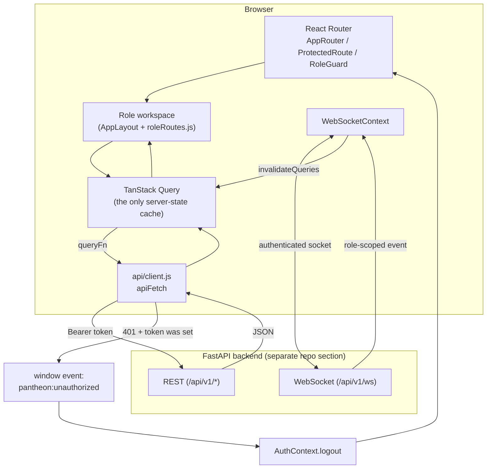

# Pantheon Frontend

## What this is

This is the browser client for Pantheon, the multi-agent AI system for Colombo port congestion and customs clearance. The backend (FastAPI + LangGraph + PostgreSQL, documented in `../backend/README.md`) already enforces every rule that matters: who can see which shipment, who can decide a review, who gets which realtime event. The frontend's job is narrower and more honest about its scope — give each of the six roles (shipping agent, customs officer, port operations, importer/exporter, management, admin) a workspace that shows them exactly the slice of the system that is theirs, keep that workspace live without the user ever hitting refresh, and make the handful of consequential actions (submitting a shipment, deciding a review) hard to get wrong.

Nothing here is a second authorization system. The React Router guards that keep a user inside their own role's URL space, the `usePermission` hook that hides a button a role can't use — these exist for a good user experience, not security. They are explicitly commented as such in the source, and this document says so again, loudly, in its own section below, because it is the single most important architectural fact about this codebase.

## Architectural philosophy

The frontend is a thin, honest client over a REST + WebSocket API, not an application with its own model of the domain. There is no Redux store duplicating server state, no client-side business logic deciding whether a shipment is "really" high risk, and no local cache that is treated as more trustworthy than the next response from the server. TanStack Query is the only place server data lives; when the server's view of the world changes — a workflow advances, a review is decided, a new shipment appears — a query is invalidated and refetched, not patched by hand from guesses about what must have changed.

That single decision shapes almost everything else in this codebase:

- **Routing is a view switcher, not a gate.** `AppRouter.jsx` nests role-specific pages under `/app/:roleSlug/...`. `ProtectedRoute` checks that a session exists; `RoleGuard` checks that the URL's role slug matches the signed-in user's own role. Both exist purely so a signed-in user's browser shows the right screen — neither is, or is meant to be, a security boundary. See **Route guards are UX, not security** below.
- **One config object drives the whole workspace shell.** `src/routes/roleRoutes.js` is the single source of truth for every role's URL slug, label, tagline, left-nav items, and whether that role gets the AI assistant (`hasAssistant`, false only for admin). `AppLayout.jsx` and `Sidebar.jsx` render purely from this object — there is no per-role layout component to keep in sync.
- **The WebSocket is a cache-invalidation signal, never a second source of truth.** `WebSocketContext.jsx` opens one authenticated socket per session and, on every event, invalidates the TanStack Query keys that event could have changed (`review.*` events invalidate `['reviews']`, `workflow.*`/`shipment.*` events invalidate `['shipments']` and the specific workflow's key). The REST response that follows is what the UI actually renders. If the socket drops, nothing is lost — queries fall back to their own `refetchInterval` or the next manual refetch; when it reconnects after a gap, the whole cache is invalidated once to resync.
- **No modal dialogs anywhere in the codebase.** Every form that needs to appear — creating a user, confirming a review decision — is an inline, expandable section of the page it belongs to (`<details>`-like `useState` toggles), not an overlay. This is a consistent, deliberate pattern across `AdminPages.jsx`, `ReviewDetailPage.jsx`, and `DocumentsCard.jsx`, not an accident of which components happened to get built first.

## System architecture



Every arrow into "Backend" crosses the one trust boundary that matters: the backend re-checks permissions on every request regardless of what the browser side of this diagram displays or hides.

## Why these technology choices

| Choice | Why |
|---|---|
| **React 19** | Nothing exotic is asked of it here (no Server Components, no `use()` data fetching) — it's the current stable release and gives ordinary hooks-based components, which is all this app needs. |
| **Vite 8** | Fast dev server and HMR for a codebase with four dozen small feature components; its plugin model is also what makes the Tailwind v4 integration a one-line `plugins` entry instead of a separate PostCSS pipeline. |
| **TanStack Query 5, not Redux/Zustand** | The app has almost no client-only state worth a global store — nearly everything meaningful (shipments, reviews, workflows, users) *is* server state with a clear cache key and a clear invalidation trigger. A general-purpose state manager would just be reimplementing what a server-state library already does well: caching, retry, background refetch, and — critically here — a clean `invalidateQueries` hook for the WebSocket layer to call into. Introducing Redux alongside it would mean deciding, for every piece of data, which store owns the truth; TanStack Query avoids that question by being the only answer. |
| **React Router 7** | Nested routes map directly onto the `/app/:roleSlug/section` shape the backend's role model suggests, and `Outlet`-based layouts let one `AppLayout` wrap every role's pages without duplicating the shell. |
| **Tailwind v4 via `@tailwindcss/vite`, not a PostCSS config** | Tailwind v4's first-party Vite plugin (`@tailwindcss/vite`) replaces what used to be a `postcss.config.js` plus `tailwind.config.js` pair; theme tokens (the brand's cream/ink/orange palette, status colors, fonts) live directly in `src/styles/index.css` under `@theme`, in one file, with no separate build-tool config to keep in sync with it. |
| **Dev server pinned to port 3000, with `strictPort: true`** | `vite.config.js` carries a comment explaining this isn't a style preference: Vite's default port 5173 falls inside the Windows Hyper-V reserved port range (5118–5217) on the development machine this project was built on, so Vite would silently fail to bind. Port 3000 sits outside that range. |
| **three.js, lazy-loaded, only on the public landing page** | `HeroScene.jsx` only triggers `import('./heroSceneEngine')` once it has confirmed WebGL is available, and only the host page (`IndexPage.jsx`) ever imports `HeroScene`. Nothing inside the authenticated `/app/*` workspace pulls three.js into its bundle. `vite.config.js` raises `chunkSizeWarningLimit` to 650 specifically because this one chunk is a deliberate, disclosed ~575 kB — not an unnoticed regression. |
| **lucide-react** | A single consistent icon set used everywhere from status badges to the chat launcher, rather than mixing icon libraries or hand-drawn SVGs per feature. |

## Routing and the role workspace

`src/routes/AppRouter.jsx` defines two public routes (`/` — the marketing `IndexPage`, and `/login`) and one authenticated subtree:

```
/app                      -> redirects to the signed-in user's own dashboard
/app/:roleSlug            -> RoleGuard (slug must match the user's own role)
  /dashboard              -> DashboardPage (role-specific overview via RoleOverview.jsx)
  /shipments              -> ShipmentsListPage
  /shipments/:shipmentId  -> ShipmentDetailPage (WorkflowPanel + DocumentsCard + timeline)
  /submit                 -> SubmitShipmentPage
  /review-queue           -> ReviewQueuePage
  /review-queue/:reviewId -> ReviewDetailPage (decision form)
  /vessels                -> VesselsPage
  /analytics              -> AnalyticsPage
  /users /workflows /agent-runs /audit /system-health  -> admin-only pages
  /:section (anything else) -> WorkspacePlaceholder (redirects home)
```

Every one of those routes is reachable by typing the URL directly, for every role, inside a given role's own `/app/<their-slug>/...` prefix — `RoleGuard` only stops a user from wandering into *another role's* slug. Whether a given page is actually useful once you land on it (whether there's data to show, whether an action succeeds) is entirely a server-side question. `roleRoutes.js` additionally determines which of these routes a role's left-hand navigation actually surfaces as a link, so in practice a shipping agent is never shown a link to `/users` — but nothing stops the URL bar.

## Route guards are UX, not security

This needs to be stated plainly, because it is the frontend's one genuinely load-bearing architectural decision. `src/routes/ProtectedRoute.jsx` is commented in the source as "Blocks rendering until a session exists. UX only — the backend authorizes every request." `src/routes/RoleGuard.jsx` carries the same disclaimer: "Keeps users inside their own workspace URL... UX only; not a security boundary." The `usePermission` hook that hides buttons a role shouldn't see is commented identically: "Hides/shows UI based on permissions the server granted. UX only — the backend re-checks every call."

What this means concretely:

- If a shipping agent manually edits the URL to a customs officer's review-queue path, `RoleGuard` redirects them straight back to their own dashboard — but even if that redirect didn't exist, every request the resulting page would make still goes through `apiFetch` with the shipping agent's own bearer token, and the backend's own permission and resource-access checks (`require_permission`, `assert_can_access_shipment`, and the equivalent review-ownership check) would refuse it independently.
- `usePermission('review:decide')` in `ReviewDetailPage.jsx` hides the decision form from a role that can't decide reviews. Nothing about hiding that form prevents a direct `POST /reviews/{id}/decision` call from succeeding or failing — that outcome is decided entirely server-side, by permissions actually granted to the authenticated user, read fresh from the database on that request.
- The WebSocket layer follows the same shape from the other direction: the backend decides which events a given authenticated connection receives (a Customs Officer's socket gets `review.*` events; a Shipping Agent's does not), and the frontend's `isRelevant()` filter in `WebSocketContext.jsx` is a *further*, client-side narrowing on top of that — used only to decide which events are worth a toast notification, never to decide which events are safe to receive in the first place.

The frontend's guards exist to make the product *pleasant* — nobody should have to see a 403 page to learn they're in the wrong place — not to make it *safe*. Safety is the backend's job, done independently of anything the client displays.

## Authentication and the API client

`src/api/client.js` exports a thin `apiFetch` wrapper around `fetch`: it resolves the base URL from `VITE_API_URL`, attaches `Authorization: Bearer <token>` when a token is present, serializes JSON bodies (or passes `FormData` through untouched, for document uploads), and normalizes every failure into an `ApiError` carrying an HTTP status and a backend-supplied error code. The bearer token itself lives in `localStorage` under the key `pantheon.token`, managed by the small `tokenStore` object in the same file (`get` / `set` / `clear`).

The one piece of cross-cutting plumbing worth calling out: if `apiFetch` receives a `401` *and* a token was present at the time (i.e. this was a previously-valid session suddenly being rejected, not just an anonymous request), it dispatches a plain browser `CustomEvent('pantheon:unauthorized')` on `window`. `AuthContext.jsx` listens for that event for the lifetime of the app and calls `logout()` in response — clearing the stored token, resetting auth state to `'anonymous'`, and clearing the entire TanStack Query cache (`queryClient.clear()`), so a revoked or expired session can never leave stale, authorized-looking data sitting in memory. This is the only mechanism by which an API response can force a logout; `AuthContext` does not poll for token expiry on its own.

On successful login, `AuthContext.login()` stores the access token, then immediately calls `getMe()` to resolve the account's role and permission list from the server — the frontend never guesses or caches a role across sessions, and `dashboardPathFor(role)` is what turns that server-supplied role into the correct `/app/<slug>/dashboard` redirect.

## Server state and realtime updates

`src/hooks/useShipments.js` and `src/hooks/useReviews.js` are the two hook modules every shipment- and review-related page builds on. The pattern is consistent throughout: a `useQuery` per resource, keyed by a small, explicit key factory (`shipmentKeys.all`, `shipmentKeys.detail(id)`, etc.), and a `useMutation` per write action that invalidates the specific keys that action could have changed. Submitting a review decision (`useSubmitDecision`), for instance, invalidates both `['reviews']` and `['shipments']` — on success *and* on a `409` conflict (another officer having already decided the same case), since even a failed decision attempt means the review's current state should be re-fetched.

`useWorkflow(workflowId)` layers a polling fallback on top of this: while a workflow's status is `RUNNING` or `PENDING`, it refetches on an interval that shortens from 10 seconds to 3 seconds whenever the WebSocket connection is not `'live'`. This exists because, as the hook's own comment notes, the backend currently has no event that tells a *shipping agent* specifically "this workflow just paused for review" — so for that one case, a slow background poll is the safety net under the WebSocket, not the primary mechanism.

`WebSocketContext.jsx` opens exactly one authenticated socket per signed-in session (`${VITE_WS_URL}?token=...`), reconnects with exponential backoff (1s up to a 30s ceiling) on an unexpected close, and sends a bare `"ping"` every 25 seconds to keep the connection alive. Every incoming event runs through a single `handleEvent` function that does two independent things: it invalidates the TanStack Query keys that event type could affect (regardless of whether this particular event turns out to be "relevant" to this user — invalidation is cheap and the REST refetch re-checks access anyway), and, separately, it decides whether the event is worth surfacing as a notification (`describe()` turns a known event type into a human-readable title and body; an unrecognized event type is invalidated but never shown). After a reconnect that follows a real gap in connectivity, the entire query cache is invalidated once, to resync anything that might have changed while the socket was down — the comment in the source ties this directly back to the backend architecture document's own numbered section on this behavior.

One piece of client-only state exists alongside all of this and is worth naming because it is a known, disclosed gap rather than an oversight: `src/utils/workflowMemory.js` remembers, in `localStorage`, which `workflow_id` was last started for a given shipment in *this browser*. The comment in that file explains why: the backend has no `GET /shipments/{id}/workflows` endpoint yet, so there is no server-side way to ask "has a workflow already run for this shipment" from a different browser or a different user's session. Until that endpoint exists, `WorkflowPanel.jsx` can only know about a workflow it (or this same browser, earlier) itself started.

## Component structure

- **`components/common/`** holds the generic, content-agnostic primitives every page is built from: `Button` (three visual variants, a built-in loading spinner state), `Card` (the bordered section shell with an optional title/action header used on almost every page), `StatusBadge` (maps a raw backend status string like `AWAITING_REVIEW` or `HIGH` onto one of five semantic tones — success, progress, attention, danger, neutral — each with both a color *and* an icon, so meaning never depends on color alone), and `QueryStates` (`LoadingState`, `ErrorState`, `EmptyState` — the three states almost every data-driven page needs and none of them hand-roll individually).
- **`components/workflow/ResultView.jsx`** is a single generic, recursive renderer for "whatever structured object an agent returned." Because each of the six workflow agents returns a differently-shaped result, this component just walks the value — primitives print as text (or a `StatusBadge`, if they look like a status enum), arrays become bulleted lists, and objects become a label/value definition list, recursing at every level. It is reused verbatim in two places that have no other code in common: `WorkflowPanel.jsx` (rendering a running or finished workflow's per-agent output) and `ReviewDetailPage.jsx` (rendering the risk/document/tracking/congestion snapshot captured at the moment a review was raised). Writing one generic renderer here, instead of a bespoke view per agent type, is what let the review detail page show upstream agent evidence without needing to know in advance what shape any given agent's output takes.
- **`components/cards/StatTile.jsx`** and **`components/charts/BarList.jsx`** are the two building blocks every dashboard-style page (`RoleOverview.jsx`, `AnalyticsPage.jsx`, the admin pages) composes from: a single headline number with an optional "needs attention" accent, and a horizontal, directly-labeled bar chart for a single series of counts (by status, by role, by port) that reuses `StatusBadge`'s tone logic so a "Failed" bar and a "Failed" pill are colored identically.
- **`components/notifications/`** holds the realtime-facing UI that all reads from `WebSocketContext`: `ConnectionIndicator` (a small "Live / Connecting / Reconnecting / Offline" pill), `NotificationBell` (a dropdown of recent events, each one deep-linking to the shipment or review it concerns), and `Toaster` (briefly surfaces the newest 3 notifications as dismissible toasts, independent of whether the bell's dropdown is open).
- **`components/chatbot/ChatWidget.jsx`** is the floating per-role AI assistant, mounted by `AppLayout` only when `roleConfig.hasAssistant && user.permissions.includes('chat:use')` both hold — so even for the five roles configured with an assistant in `roleRoutes.js`, the widget still won't render for a user whose server-granted permissions don't include `chat:use`. Conversation history before the current browser session can't be reloaded (the backend has no endpoint for it yet), which the widget discloses in-UI rather than silently pretending an older conversation is empty.
- **`components/navigation/Sidebar.jsx`** renders the left-hand nav purely from the `nav` array on the current role's `roleRoutes.js` entry, so adding or removing a role's visible section is a one-line config change, never a Sidebar code change.

## Admin pages and the inline-form pattern

`features/admin/AdminPages.jsx` exports five page components — `UsersPage`, `WorkflowsPage`, `AgentRunsPage`, `AuditPage`, `SystemHealthPage` — all mounted only under the admin role's nav. `UsersPage` is the clearest example of a pattern that holds everywhere in this codebase: creating a user is not a modal dialog, it's a `showCreate` boolean that toggles an inline `<CreateUserForm>` section open directly in the page flow, right above the existing users table. Per-row role and active/inactive changes are likewise inline controls (a `<select>` and a clickable status pill) that fire a mutation immediately, rather than opening an edit dialog first. There is no modal component anywhere in this codebase to reach for instead — this inline-expansion approach is the deliberate, consistent way this app handles "add or edit something without leaving the page," used identically in the review decision form and the document uploader.

`AgentRunsPage` and `AuditPage` both render an explicit, honest empty state rather than pretending there's simply no data: the UI tells the admin directly that agent-run and audit-log persistence aren't wired up on the backend yet (matching the backend README's own "known gap" section on the unused `AgentRun`/`AuditLog` tables), instead of showing a generic "no results" message that would look identical to "nothing has happened yet."

## The landing page and HeroScene

`features/landing/IndexPage.jsx` is the only route that makes zero network calls — a static marketing page describing the product, with a "Sign in" link into `/login`. Its hero section hosts `HeroScene.jsx`, a decorative three.js port visualization (a ship arriving at a quay, a gantry crane cycling containers, a container yard, fog, and a slow camera drift — all built from the brand's own cream/ink/orange palette with no external models or textures, per `heroSceneEngine.js`).

`HeroScene` is deliberately careful about when it does and doesn't spend resources:

- It checks `webglAvailable()` synchronously on mount; if WebGL isn't available (or the dynamic `import('./heroSceneEngine')` ever rejects), it falls back to a static inline SVG illustration of the same scene, so the hero section never shows a blank box.
- The three.js engine module itself is only ever `import()`-ed from inside this one component, so no page in the authenticated `/app/*` workspace pays for any part of that bundle.
- It respects the OS-level `prefers-reduced-motion` setting by reading `window.matchMedia('(prefers-reduced-motion: reduce)').matches` once, into a ref, at the moment the scene is created — not as a piece of reactive state, and with no user-facing play/pause control. That control was considered and deliberately removed; the scene simply starts still for a reduced-motion user rather than exposing a toggle for a decision the OS has already made.
- It stops calling `scene.render()` (though the render loop keeps running via `requestAnimationFrame`) whenever the host element scrolls out of view (`IntersectionObserver`) or the tab is hidden (`document.hidden`), and uses a lower render resolution and no antialiasing on narrow or low-core-count devices.

## Use cases, from the frontend's perspective

### 1. Shipping agent submits a shipment and watches it clear

From `ShipmentsListPage`, the agent clicks "New shipment" (visible only because `usePermission('shipment:create')` is true for this role) into `SubmitShipmentPage`'s single-page form. On success, they land on `ShipmentDetailPage?new=1`, which shows a one-time "next, upload documents" banner. They drag a PDF into `DocumentsCard`'s uploader (client-side checks the MIME type and a 20 MB limit before ever calling the server, mirroring but not replacing the backend's own validation), then click "Start AI analysis" in `WorkflowPanel`. The mutation returns a `workflow_id` immediately, which `useStartWorkflow` remembers via `workflowMemory.js` and uses to start polling/subscribing. As the six agent stages complete, `WorkflowPanel` renders each one's result through `ResultView`, and the page updates live as `workflow.*` WebSocket events arrive — no manual refresh.

### 2. Shipping agent's shipment gets escalated

Same flow, but the Documentation Agent reports missing fields and the Risk Agent (or its deterministic fallback) escalates. `WorkflowPanel` shows `status: AWAITING_REVIEW` with an explicit banner: "Paused for human review. A customs officer must decide before scheduling continues." The agent cannot see or influence the review queue — their permissions don't include `review:decide` — but their own shipment page keeps updating live once an officer acts, because the same `shipment.*`/`workflow.*` invalidation path fires regardless of which role triggered the change.

### 3. Customs officer works the queue

`ReviewQueuePage` lists every `PENDING` review via `useReviewQueue`, sorted by priority then by how long each has waited, and updates live as `review.created` events invalidate `['reviews']`. Opening one into `ReviewDetailPage` shows the shipment summary, the full upstream evidence snapshot (`UpstreamContext`, rendered through the same generic `ResultView` used in `WorkflowPanel`), and a `DecisionForm` with three choices — approve the recommendation, request more information, or reject — each with its own required-comment rule enforced client-side before the request is even sent. Submitting goes through a two-step "review, then confirm" flow (the decision "resumes the workflow and can't be undone," as the confirmation copy says); a `409` response (another officer having already decided this case moments earlier) is shown as a specific, named conflict message rather than a generic error.

### 4. Customs officer asks the assistant about the queue

The floating `ChatWidget` is available to this role (`hasAssistant: true` for `customs_officer`, provided the server also granted `chat:use`). Its suggested-question chips ("What's pending in my review queue?", "Explain why a shipment was escalated.") come straight from `roleRoutes.js`. The widget sends plain text to `POST /chat/conversations/{id}/messages` and renders whatever comes back; it never decides on the officer's behalf what the assistant is allowed to know — that's resolved server-side, identically to every other role's assistant.

### 5. Port operations watches vessels and congestion

`VesselsPage` lists tracked vessels and, per vessel, a position history table that explicitly labels each row's data `source` (simulated vs. live), matching the backend's own disclosure that tracking data is currently a calibrated simulator. `RoleOverview`'s port-operations variant surfaces shipment counts by destination port and vessels tracked, both via plain `useQuery` calls scoped to endpoints this role is permitted to call.

### 6. Management reviews aggregate performance

`AnalyticsPage` and the management variant of `RoleOverview` both read from `GET /analytics/dashboard` — total shipments, workflow run counts, breakdowns by status and risk level — and nothing more granular. There is no UI path from this role into an individual shipment's risk evidence or a specific officer's decision history, because the permissions the backend grants this role don't expose that data in the first place; the frontend simply has nothing to call for it.

### 7. Admin manages the system, with no chatbot

The admin's left nav (from `roleRoutes.js`, `hasAssistant: false`) points at `UsersPage` (search/filter users, inline-create an account, change a role or activate/deactivate an account per row), `WorkflowsPage` (workflow counts by status, refreshed every 15 seconds), `AgentRunsPage` and `AuditPage` (both showing an honest "not wired up yet" empty state rather than a misleading "no results"), and `SystemHealthPage` (polls `GET /admin/health` every 30 seconds and combines it with this browser's own live WebSocket connection state into one checklist: API, database, live updates, LLM providers, document storage). `AppLayout` never mounts `ChatWidget` for this role at all — not hidden by CSS, simply never rendered — matching the backend's own position that an admin console is a monitoring surface, not an operational one with anything useful for an assistant to do.

## Setup and running locally

1. Install dependencies:
   ```bash
   npm install
   ```
2. Copy the environment template and point it at a running backend:
   ```bash
   cp .env.example .env
   ```
   `.env.example` sets:
   ```
   VITE_API_URL=http://localhost:8000/api/v1
   VITE_WS_URL=ws://localhost:8000/api/v1/ws
   ```
   Adjust both if the backend runs somewhere other than `localhost:8000` (see `../backend/README.md` for getting the backend itself running, including its own seeded demo accounts for each role).
3. Start the dev server:
   ```bash
   npm run dev
   ```
   This serves the app at `http://localhost:3000` — not Vite's default 5173, for the Hyper-V port-range reason explained above. `strictPort: true` in `vite.config.js` means it will fail loudly rather than silently falling back to a different port if 3000 is already taken.
4. `npm run build` produces a production bundle; `npm run preview` serves that build locally for a final check before deploying.

## Tech stack

- **React 19** for UI, with **React Router 7** for role-scoped client-side routing.
- **Vite 8** as the dev server and bundler, with `@vitejs/plugin-react` and `@tailwindcss/vite`.
- **Tailwind CSS v4** for styling, with brand/status tokens defined once in `src/styles/index.css`.
- **TanStack Query 5** as the sole server-state and caching layer — no Redux, no Zustand.
- **three.js**, lazy-loaded, for the landing page's decorative hero scene only.
- **lucide-react** for icons throughout.
- A native browser `WebSocket`, wrapped by `WebSocketContext`, for realtime event delivery — no socket.io or similar abstraction layer.

## Directory index

- `src/api/` — one thin wrapper module per backend domain (`auth`, `shipments`, `reviews`, `admin`, `analytics`, `chat`, `tracking`), all built on the shared `apiFetch` in `client.js`.
- `src/hooks/` — TanStack Query hooks (`useShipments`, `useReviews`) and the UX-only `usePermission` guard.
- `src/contexts/` — `AuthContext` (session, login/logout, the `pantheon:unauthorized` listener) and `WebSocketContext` (the realtime connection, notifications, and cache invalidation).
- `src/routes/` — `AppRouter`, `ProtectedRoute`, `RoleGuard`, and `roleRoutes.js`'s per-role configuration.
- `src/layouts/AppLayout.jsx` — the shared dashboard shell (sidebar, header, chat widget) every role's pages render inside.
- `src/features/` — one directory per product area: `landing`, `auth`, `dashboard`, `shipments`, `reviews`, `tracking`, `analytics`, `admin`.
- `src/components/` — `common` (generic primitives), `workflow` (`ResultView`), `cards`, `charts`, `chatbot`, `navigation`, `notifications`.
- `src/utils/` — `format.js` (date/byte/string formatting helpers) and `workflowMemory.js` (the disclosed, browser-local workaround for the missing "workflows for this shipment" endpoint).
